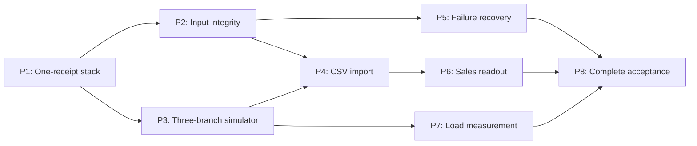

# M1 tracer-bullet ticket breakdown

Parent: [stkorn/kindaros#1](https://github.com/stkorn/kindaros/issues/1)

สถานะ: ผู้ใช้ยืนยัน breakdown แล้ว และ publish ครบ 8 tickets พร้อม ready-for-agent; ตรวจ native blocking dependencies ครบ 10 edges และ parent #1 ไม่เปลี่ยนแปลง P1–P8 เป็น planning IDs ซึ่ง map กับ GitHub issues ในตารางด้านล่าง

ขอบเขตของทุกใบคือ completed SALE สำหรับ BR001–BR003 ตาม parent ไม่มี Payment, UI, Refund, Kitchen, Royalty หรือ AWS งานนี้ไม่แก้หรือปิด parent issue

## Published tickets

| Planning ID | GitHub issue | Blocked by |
| --- | --- | --- |
| P1 | [#2 — [M1/P1] ส่งบิลตัวอย่างผ่าน local stack จริงและอ่านผลได้](https://github.com/stkorn/kindaros/issues/2) | None |
| P2 | [#3 — [M1/P2] รักษายอดขายเมื่อ event ซ้ำ เปลี่ยนยอด หรือข้อมูลผิด](https://github.com/stkorn/kindaros/issues/3) | [#2](https://github.com/stkorn/kindaros/issues/2) |
| P3 | [#4 — [M1/P3] จำลองยอดขาย 3 สาขาและตรวจเทียบ manifest ได้](https://github.com/stkorn/kindaros/issues/4) | [#2](https://github.com/stkorn/kindaros/issues/2) |
| P4 | [#5 — [M1/P4] Import CSV แบบ preflight และ reimport โดยไม่เพิ่มยอด](https://github.com/stkorn/kindaros/issues/5) | [#3](https://github.com/stkorn/kindaros/issues/3), [#4](https://github.com/stkorn/kindaros/issues/4) |
| P5 | [#6 — [M1/P5] Restart และ replay หลัง failure โดยไม่สูญหรือเพิ่มยอด](https://github.com/stkorn/kindaros/issues/6) | [#3](https://github.com/stkorn/kindaros/issues/3) |
| P6 | [#7 — [M1/P6] อ่านยอดรายสาขา สินค้า และวัน Bangkok แยก source ได้](https://github.com/stkorn/kindaros/issues/7) | [#5](https://github.com/stkorn/kindaros/issues/5) |
| P7 | [#8 — [M1/P7] วัด load และ acknowledged-to-DB latency แบบตรวจซ้ำได้](https://github.com/stkorn/kindaros/issues/8) | [#4](https://github.com/stkorn/kindaros/issues/4) |
| P8 | [#9 — [M1/P8] รัน acceptance ทั้ง M1 จาก clean environment และส่งมอบ runbook](https://github.com/stkorn/kindaros/issues/9) | [#6](https://github.com/stkorn/kindaros/issues/6), [#7](https://github.com/stkorn/kindaros/issues/7), [#8](https://github.com/stkorn/kindaros/issues/8) |

## Approved dependency graph

เมื่อ P1 เสร็จ P2/P3 เริ่มได้; P2 เปิดทางให้ P5; P4 รอทั้ง P2/P3 เพราะต้องใช้ identity/rejection behavior และ manifest reconciliation ที่ส่งมอบแล้ว Dependencies ไม่ได้หมายถึงอนุญาตให้ agent หลายตัวเขียน shared modules พร้อมกัน ต้องจัด file ownership ในการลงมือจริง

## P1: ส่งบิลตัวอย่างผ่าน local stack จริงและอ่านผลได้

### Parent

https://github.com/stkorn/kindaros/issues/1

### What to build

ผู้พัฒนารัน environment จาก clean checkout ส่ง completed receipt ตัวอย่างผ่าน CLI → Kafka KRaft → Spark Structured Streaming → PostgreSQL แล้วอ่าน receipt และยอดที่ commit แล้วได้ เป็นเส้นทางแรกที่ใช้ infrastructure จริงทั้งหมด

รวม baseline verification, reproducible build, repository foundation, bootstrap และ schema เท่าที่จำเป็นต่อ receipt นี้ในใบเดียว ใช้ reference artifacts ที่อนุมัติแล้วเป็นฐานและเก็บ artifacts/configuration ที่จำเป็นใน repository ด้วย เพื่อไม่ให้ clean checkout พึ่งไฟล์ที่อยู่เฉพาะ workspace เดิม

### Acceptance criteria

- [ ] ตรวจ candidate baseline Kafka 4.4.0, Spark/PySpark 4.2.1, Scala connector 2.13, Java 21, Python 3.12.14 และ PostgreSQL 18.6 กับ registry/runtime จริง; ถ้าใช้ไม่ได้ต้อง reconcile baseline พร้อมหลักฐานก่อนเดินต่อ ไม่ใช้ latest หรือ fallback เงียบ
- [ ] บันทึก image manifest/dependency locks และตรวจ image/wheel availability สำหรับ linux/amd64 และ linux/arm64 แยกจาก runtime architecture ที่รันทดสอบจริง
- [ ] Build แล้วเริ่ม runtime ได้โดยไม่ดาวน์โหลด dependency เพิ่มจาก Maven/PyPI ใช้ non-root app runtime และเขียน checkpoint ได้
- [ ] Bootstrap ใช้ Kafka KRaft หนึ่ง combined node โดยไม่มี ZooKeeper มี topic 3 partitions/RF1 และ seed BR001–BR003 พร้อม catalog; รัน bootstrap ซ้ำไม่เพิ่ม seed หรือ apply migration ซ้ำ และ checksum/config mismatch ต้อง fail
- [ ] Container และ host client ใช้ advertised listeners ของตนได้ Runtime DB role มีสิทธิ์ตามหน้าที่และแก้/ลบ accepted sales ไม่ได้
- [ ] Canonical v1 completed receipt ที่มี 2 lines, 3 units, gross 130.00, discount 10.00, net 120.00 ผ่าน pipeline แล้วมี header/lines ที่ครบตรง input; ใช้ deterministic identity และ Decimal/NUMERIC ตั้งแต่เส้นทางแรก
- [ ] Header และ lines commit ใน transaction เดียว PostgreSQL ปฏิเสธ header ที่ไม่มี lines/ยอดไม่ตรง และห้าม append line เข้า receipt ที่ commit แล้ว
- [ ] มี end-to-end smoke ที่พิสูจน์ผลจาก PostgreSQL จริง, doctor ตรวจ dependency readiness, และ CI รัน smoke นี้ได้; ไม่ถือ mock หรือ config parse เป็น runtime proof

### Blocked by

None (can start immediately).

## P2: รักษายอดขายเมื่อ event ซ้ำ เปลี่ยนยอด หรือข้อมูลผิด

### Parent

https://github.com/stkorn/kindaros/issues/1

### What to build

ผู้ใช้ส่ง receipt เดิมซ้ำหรือส่งข้อมูลผิดเข้า pipeline แล้วตรวจได้ว่ายอด accepted ไม่เพิ่มหรือถูกทับ ข้อมูลผิดมี durable rejection และ valid receipts ใน batch เดียวกันยังลงได้ครบ

### Acceptance criteria

- [ ] Business key ใช้ source system, stable installation, branch, Bangkok calendar date และ receipt ID; deterministic UUID/hash ไม่เปลี่ยนเมื่อ produced_at หรือลำดับ lines เปลี่ยน และไม่ใช้ filename/import time เป็น identity
- [ ] ส่ง sample เดิม 10 ครั้งยังมี accepted receipt 1 ใบ, lines 2 และยอด 120.00; replay transport coordinate เดิมรักษา outcome เดิม ส่วน offset ใหม่ถูกบันทึก duplicate
- [ ] Key เดิม/hash ต่างเกิด IDENTITY_CONFLICT ทั้งภายใน batch เดียวและข้าม batch รักษา original โดยใช้ deterministic transport ordering
- [ ] Wrong event ID/Kafka key, malformed bytes/JSON, duplicate JSON property, unsupported schema/type, unknown branch/product และ oversize input ได้ durable reason/raw input โดยไม่กลืน infrastructure failure
- [ ] Financial/time validation ปฏิเสธ float, จำนวนเงินผิด precision, totals ต่างแม้ 0.01, line IDs ซ้ำ, date ที่ไม่ตรง occurred_at และ tax ที่เกิน net; not_provided tax แยกจาก explicit tax
- [ ] Ledger, lines และ delivery outcomes commit พร้อมกันต่อ bounded microbatch ใช้ explicit transaction โดยไม่มี implicit outer transaction ค้างก่อน checkpoint
- [ ] เปิด sink สอง processes แล้วมีเพียงตัวเดียวได้ writer lock ถ้า connection/lock หายต้องหยุด ไม่เขียนต่อผ่าน connection ที่ไม่มี lock
- [ ] Mixed valid/poison batch ให้ valid receipts ครบและ rejected receipts ไม่กระทบยอด; unexpected DB constraint/configuration errors ทำให้ rollback/fail และไม่ถูกแปลงเป็น poison rejection

### Blocked by

- P1: ส่งบิลตัวอย่างผ่าน local stack จริงและอ่านผลได้

## P3: จำลองยอดขาย 3 สาขาและตรวจเทียบ manifest ได้

### Parent

https://github.com/stkorn/kindaros/issues/1

### What to build

ผู้ใช้สั่ง simulator แบบ deterministic ส่ง completed sales ของทั้ง 3 สาขาผ่าน pipeline แล้วสั่ง verify ให้เทียบ receipt IDs, hashes, lines และยอดเงินกับ manifest ได้ โดยไม่ต้องตรวจ DB ด้วยมือ

### Acceptance criteria

- [ ] Seed/run/start-time เดิมให้ sale payload เดิม Receipt ID แยก run โดยไม่เปลี่ยน stable source installation และใช้ catalog จำลองตาม parent
- [ ] Run 300 receipts กระจาย 100 receipts ต่อ BR001/BR002/BR003 พร้อม expected per-branch counts/totals
- [ ] Producer รอ acknowledgement จริง แยก acknowledged/failed/unknown delivery และ flush timeout ไม่ถูกแสดงเป็น success
- [ ] Manifest เก็บ durable นอก ephemeral container และ verify อ่านได้ข้าม services หลัง simulator container จบ
- [ ] Verify รอ DB completion แล้วเทียบ exact expected receipt ID/hash/line count และ Decimal totals; missing/extra/hash mismatch หรือ timeout ให้ failure ไม่เทียบเพียงยอดรวม
- [ ] มี end-to-end test ส่ง 300 receipts แล้ว verify ผ่านบน stack จริง และ negative test ที่ missing/extra ยอดหักล้างกันยังตรวจพบ
- [ ] CI เพิ่ม deterministic simulator/manifest test จาก smoke ของ P1 และเก็บผลที่อ่านตรวจได้

### Blocked by

- P1: ส่งบิลตัวอย่างผ่าน local stack จริงและอ่านผลได้

## P4: Import CSV แบบ preflight และ reimport โดยไม่เพิ่มยอด

### Parent

https://github.com/stkorn/kindaros/issues/1

### What to build

ผู้ใช้ dry-run synthetic itemized CSV เห็นผลตรวจ/ยอดก่อนส่งจริง เมื่อ publish แล้ว verify ตาม import report ได้ และนำไฟล์ที่เปลี่ยนชื่อ เรียงแถวใหม่ หรือมีช่วงข้อมูลทับกันเข้าอีกครั้งโดยไม่เพิ่มยอด accepted

### Acceptance criteria

- [ ] Default เป็น dry-run ไม่มี publish จนสั่ง explicit publish; มี explicit mapping สำหรับ encoding, headers, IDs, product/branch codes, status, timestamp และ monetary semantics
- [ ] อ่าน/validate ทั้งไฟล์และประกอบ complete receipts ก่อน publish ตรวจ repeated header totals, stable unique lines และ receipt completeness; รองรับ UTF-8/BOM, Thai/quoted fields และ explicit cp874
- [ ] Invalid row แม้เพียงหนึ่งแถว, incomplete/duplicate lines, unknown mapping/SKU/branch, summary/refund/void/unsupported layout หรือเกิน file limits ทำให้ publish ศูนย์และมี report
- [ ] Read-only preflight ตรวจ existing accepted receipt ถ้า key เดิม/hash ต่างให้หยุดก่อน publish; DB unavailable ต้อง fail ไม่ข้าม check และ sink ยังตรวจ race/conflict ซ้ำ
- [ ] Report มี file/mapping hashes, plan totals, acknowledged/failed/unknown counts และ output durable แบบ atomic; manifest verification แยก Kafka acknowledgement จาก DB completion
- [ ] Reimport ไฟล์เดิมที่ rename/reorder หรือ overlapping receipts ให้ count/ยอดเดิม; crash หลัง publish บางส่วนแล้ว reimport ทั้งไฟล์ยังได้ยอดครบครั้งเดียว
- [ ] Imported source แยกจาก simulator; fixture mapping ระบุ synthetic/unapproved ชัดเจน ไม่มี public Wongnai API assumption และไม่อ้าง production support ก่อนเห็น sanitized export ที่ตรวจครบ
- [ ] CI ใช้ synthetic fixtures ทดสอบ dry-run, failure และ import → stream → DB → verify ครบโดยไม่ใช้ข้อมูลร้านจริง

### Blocked by

- P2: รักษายอดขายเมื่อ event ซ้ำ เปลี่ยนยอด หรือข้อมูลผิด
- P3: จำลองยอดขาย 3 สาขาและตรวจเทียบ manifest ได้

## P5: Restart และ replay หลัง failure โดยไม่สูญหรือเพิ่มยอด

### Parent

https://github.com/stkorn/kindaros/issues/1

### What to build

Operator หยุด/เริ่ม process หรือ infrastructure และ replay ข้อมูลที่ยังเก็บอยู่ได้ โดย receipt ครบและยอดเดิม ระบบแจ้ง gap เมื่อข้อมูลต้นทางไม่พอให้ recovery แทนการ skip เงียบ

### Acceptance criteria

- [ ] Inject crash หลัง header insert ก่อน commit แล้วไม่เห็น partial receipt; restart/replay ได้ header/lines/delivery ครบครั้งเดียว
- [ ] Inject crash หลัง DB commit ก่อน foreachBatch return/checkpoint แล้ว restart ไม่เพิ่ม receipt หรือยอด และมี test สำหรับ commit acknowledgement ที่ไม่แน่นอน
- [ ] DB stop ระหว่าง batch ทำให้ rollback/fail โดยไม่บันทึก batch completion; เมื่อกลับมาและ restart ได้ทุก expected receipt โดยไม่สร้าง false rejection
- [ ] Kafka stop/restart แสดง delivery outcome ตามจริง Resend input ที่ยังไม่ยืนยันได้โดยไม่เพิ่มยอด accepted
- [ ] down/up ที่เก็บ volumes รักษา Kafka/PostgreSQL/checkpoint state; reset checkpoint และ replay retained log ไม่เปลี่ยน business totals แม้ batch IDs เริ่มใหม่
- [ ] Cluster/topic/stream epoch binding อยู่ใน persistent control state Runtime ตรวจ mismatch; recreate topic ต้อง explicit adoption + epoch/checkpoint ใหม่ ไม่ใช้ transport IDs เก่าทับข้อมูลใหม่ และไม่ลบ sales ledger
- [ ] Retention gap ที่ checkpoint ต้องอ่านทำให้ query fail ชัดเจน; ไม่ตั้ง ignore-data-loss เพื่อให้ test ผ่าน
- [ ] Fault-injection tests รันกับ sample receipts บน stack จริงใน CI และพิสูจน์ด้วย exact accepted IDs/hashes/totals ไม่จำเป็นต้องรอ simulator load suite

### Blocked by

- P2: รักษายอดขายเมื่อ event ซ้ำ เปลี่ยนยอด หรือข้อมูลผิด

## P6: อ่านยอดรายสาขา สินค้า และวัน Bangkok แยก source ได้

### Parent

https://github.com/stkorn/kindaros/issues/1

### What to build

Analyst ใช้ SQL views/CLI สรุปยอด completed sales หลังส่วนลดก่อนคืนเงินตาม branch/product/day เลือก source ได้ และตรวจ late event กับ included-tax availability ได้ถูกต้อง โดยใช้ simulator และ CSV import จริงใน test

### Acceptance criteria

- [ ] รายงานรวม register ต่อสาขาและแยก simulator/imported source ชัดเจน จำนวนบิล/units/ยอดตรง manifest ของทั้ง 3 สาขาและ CSV fixture
- [ ] Aggregates รวมจาก accepted ledger เท่านั้น Duplicate/rejected deliveries ไม่เพิ่ม receipt count หรือยอด และไม่ใช้ incremental counters ที่ replay แล้วคลาดเคลื่อน
- [ ] Event ที่ UTC ข้ามเส้นแบ่งวัน Bangkok เข้าวันที่ถูกต้อง; late event ย้อนหลังสองวันยังถูกรวมตามวันเกิด sale โดยไม่มี watermark drop
- [ ] แสดง sales_after_discount_before_returns, included tax ที่ทราบ และจำนวน receipt ที่ไม่มี tax detail โดยไม่แสดงว่าเป็น net revenue/settlement/Eligible Net Sales
- [ ] Unknown tax component ไม่ถูกตีความเป็น VAT rate 0 และทุกยอดคำนวณ/แสดงด้วย decimal precision ที่ตรง contract
- [ ] มี rejection summary ที่ operator แยก error codes และ source coordinates ได้จาก durable audit
- [ ] CLI/SQL readout integration tests ใช้ทั้ง pipeline simulator และ CSV import ที่ส่งมอบแล้วใน P4 และผ่านใน CI ไม่มี Dashboard UI เพิ่ม

### Blocked by

- P4: Import CSV แบบ preflight และ reimport โดยไม่เพิ่มยอด

## P7: วัด load และ acknowledged-to-DB latency แบบตรวจซ้ำได้

### Parent

https://github.com/stkorn/kindaros/issues/1

### What to build

ผู้พัฒนารัน load scenario บน pipeline จริงแล้วได้รายงาน throughput, latency และ reconciliation ที่อธิบายวิธีวัดได้ แยก warm-up กับ steady-state และไม่ใช้ deterministic occurred_at แทนเวลาที่ใช้วัดจริง

### Acceptance criteria

- [ ] Warm-up 30 วินาที แล้วผลิต 5 receipts/second รวม 3 สาขานาน 120 วินาทีด้วย deterministic simulator และ run identity แยกชุด
- [ ] เริ่ม latency จากเวลาที่ delivery callback ยืนยัน success จน DB row/hash ตรวจพบ ใช้ monotonic clock ใน process วัดเดียวกัน ระบุ polling interval และวิธีรับมือ commit ที่เกิดก่อน callback
- [ ] รวม sample ทุก successful acknowledgement ไม่เลือกเฉพาะ rows ที่ตอบเร็ว รายงาน failed/unknown/rejected/missing events แยกพร้อมจำนวน samples
- [ ] Target steady-state p95 ไม่เกิน 15 วินาที และ expected valid receipts ครบหลัง drain ไม่เกิน 120 วินาที Verify exact IDs/hashes/totals ไม่ใช่เพียง throughput counter
- [ ] รายงาน hardware/runtime resources, dependency versions, producer outcomes, DB observations และ Spark progress เพื่ออธิบาย bottleneck/ขอบเขตผลวัด ไม่มี claim ว่าเป็น source-to-dashboard SLA ของ Wongnai CSV
- [ ] Automated load check มี bounded timeout และบันทึก report เป็น CI artifact; failure รายงาน actual values ไม่เปลี่ยน target หรือ skip เพื่อให้ green

### Blocked by

- P3: จำลองยอดขาย 3 สาขาและตรวจเทียบ manifest ได้

## P8: รัน acceptance ทั้ง M1 จาก clean environment และส่งมอบ runbook

### Parent

https://github.com/stkorn/kindaros/issues/1

### What to build

ผู้พัฒนาหรือ portfolio reviewer ใช้ entrypoint เดียวจาก clean checkout เพื่อรัน acceptance ทั้ง M1 และอ่านหลักฐานว่าข้อมูลถูกต้อง ทน failure และวัด performance ได้ พร้อม runbook ที่ไม่พึ่งความจำของผู้พัฒนา

### Acceptance criteria

- [ ] CI แยก run/project/volumes เพื่อไม่ใช้ state ของ laptop หรือ job ก่อนหน้า มี unit, integration, E2E, fault และ load checks ที่เพิ่มในแต่ละ ticket ไม่เริ่มเขียน test ทั้งหมดตอนท้าย
- [ ] Clean checkout build/start/doctor ผ่านโดยไม่มี manual topic/DB setup; target startup readiness ไม่เกิน 180 วินาทีหลัง build เสร็จและบันทึกเวลาจริง
- [ ] Acceptance ครบทั้ง 300-receipt reconciliation, duplicate/conflict/poison, CSV preflight/reimport, source/date/financial readouts และทุก failure/replay case จาก parent
- [ ] Runtime start ได้เมื่อ external Maven/PyPI unavailable โดยใช้ dependencies ที่ bake ไว้; persist/restart checks เก็บ state และไม่อาศัย destructive reset กลบปัญหา
- [ ] เก็บ dependency versions, reconciliation manifests/reports, error/query progress และ load results เป็น evidence ที่ inspect ได้ พร้อมผล AC01–AC12 ว่าผ่าน/ไม่ผ่านจริง
- [ ] Runbook ระบุคำสั่งใช้, SALE-only metric, fixture versus real-export gate, RF1/local limits, recovery/topic-reset procedure และจุดที่ต้องเก็บ ledger/checkpoint
- [ ] ถ้า runtime/CI gate ยังไม่ผ่านต้องรายงาน blocker โดยไม่ประกาศ M1 complete ไม่มี UI/payment/royalty หรือ milestone อื่นแทรกเข้ามา
- [ ] ส่งมอบสรุปผล acceptance โดยไม่แก้หรือปิด parent issue; ผู้ดูแลตัดสิน lifecycle ของ parent แยกต่างหาก

### Blocked by

- P5: Restart และ replay หลัง failure โดยไม่สูญหรือเพิ่มยอด
- P6: อ่านยอดรายสาขา สินค้า และวัน Bangkok แยก source ได้
- P7: วัด load และ acknowledged-to-DB latency แบบตรวจซ้ำได้

## Coverage และ publishing rules

| งานเดิมในสเปก | Ticket ที่ครอบคลุม |
| --- | --- |
| T0 Verify stack | P1 |
| T1 Foundation | P1, P8 |
| T2 Contract/domain | P1, P2 |
| T3 Database | P1, P2 |
| T4 Infrastructure | P1, P5 |
| T5 Publisher/simulator | P1, P3 |
| T6 CSV adapter | P4 |
| T7 Sink | P1, P2, P5 |
| T8 Spark wiring | P1, P5 |
| T9 E2E/recovery | ทุกใบเพิ่ม tests ของตน; P5/P7/P8 พิสูจน์ failure/load/full acceptance |
| T10 Handoff | P8 |

Publish แล้วหนึ่ง GitHub issue ต่อหนึ่ง ticket ใน dependency order พร้อม ready-for-agent โดยใช้ issue identifiers จริงใน body และตรวจ native blocking edges ครบทุกเส้น

Parent #1 ใช้ reference ใน body ของ child เท่านั้น ไม่แก้ parent body, comments, state, labels หรือ sub-issue collection ถ้าการสร้าง parent/sub-issue relationship ต้อง mutate parent ให้ใช้ Parent reference ใน child ตาม template แทน ส่วน native blocker links เขียนที่ child tickets ได้
