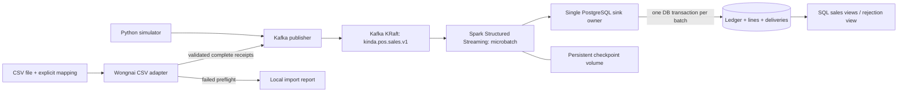

# Kinda Intelligence Milestone 1 Engineering Specification

สถานะ: พร้อมใช้เป็น implementation contract, ยังไม่ใช่ระบบที่ build และผ่าน runtime tests แล้ว

วันที่ตรวจเอกสาร: 30 ตุลาคม 2026, Asia/Bangkok • Scope: local MVP 3 สาขา

## 1. เป้าหมายและขอบเขต

M1 รับ completed sales จาก Python POS Simulator หรือไฟล์ CSV ผ่าน adapter ส่งเข้า Kafka แล้วใช้ Spark Structured Streaming เขียน PostgreSQL โดย import ซ้ำและ replay หลัง crash ไม่เพิ่มยอดขาย

อ้างอิงแผนในแชต [ไอเดียโปรเจกต์การเงิน realtime](chatgpt-conversation://6ae49166-1394-83ec-86ec-2f7e6214b073) ซึ่งกำหนด Foundation & POS Streaming สำหรับ BR001, BR002, BR003 งานนี้ส่งมอบสเปกและ reference artifacts สำหรับ Coding Agent ไม่มี existing application code ให้รักษา compatibility

ขอบเขตที่รวม:

- Docker Compose local environment, Kafka KRaft หนึ่ง node, PostgreSQL หนึ่ง instance และ Spark `local[2]`
- Event contract หนึ่ง completed receipt ต่อหนึ่ง event พร้อม item lines
- Simulator แบบ deterministic และ adapter สำหรับ synthetic itemized CSV พร้อม mapping interface สำหรับ export จริง
- Durable rejection, identity conflict detection, restart/replay และ SQL views แยกสาขา/สินค้า/วัน
- CLI สำหรับตรวจระบบ, import, ตรวจยอด และ automated tests

ขอบเขตที่ยังไม่รวม:

- ครัวกลาง, inventory, recipe, royalty, forecasting, Airflow, dbt, MinIO, AWS และ production HA
- Public realtime API, webhook, polling หรือ screen scraping ของ Wongnai
- Refund, void, correction, split payment, settlement, service charge, delivery fee, tax calculation และ fractional quantity
- Dashboard UI ใน M1 ใช้ SQL views และ CLI readout เป็น acceptance surface; UI เป็น task หลัง M1

Completed sale ใน v1 เป็น immutable observation ของบิลที่ปิดแล้ว ถ้า export มี void/refund หรือยอดสุทธิหลังคืนเงิน ให้ adapter ปฏิเสธ import นั้นทั้งชุด การแก้บิลเดิมไม่ถูก upsert ทับเงียบ

Metric คือ `sales_after_discount_before_returns`: มูลค่าขายหลังส่วนลดก่อนคืนเงิน และรวมภาษีที่ source รวมไว้แล้ว ไม่ใช่ settlement, net revenue หลัง VAT หรือรายได้ของ franchisor ข้อมูล simulator และ Wongnai ต้องเลือก source แยกกันทุก readout

## 2. Version baseline และ compatibility

ตารางนี้แยกสิ่งที่เอกสารยืนยันออกจาก stack ที่เลือก การมี release อยู่ไม่ได้ยืนยันว่า image ทุก architecture หรือ dependency ทั้งชุดผ่าน integration แล้ว

| Component | ล่าสุดที่ตรวจพบจากแหล่งทางการ | Baseline ของ M1 | Compatibility และ gate |
|---|---|---|---|
| Kafka | 4.4.0 | `apache/kafka:4.4.0` แบบ JVM | KRaft, combined broker/controller, dynamic quorum bootstrap แบบ standalone [Kafka downloads](https://kafka.apache.org/community/downloads/) |
| Spark / PySpark | 4.2.1 | `pyspark==4.2.1` | Runtime และ Kafka connector ต้อง patch เดียวกัน [Spark downloads](https://spark.apache.org/downloads.html), [4.2.1 release](https://spark.apache.org/releases/spark-release-4-2-1.html) |
| Scala | Spark 4 ใช้ 2.13 | connector suffix `_2.13` | ห้ามใช้ connector `_2.12` [Spark runtime requirements](https://spark.apache.org/docs/4.2.1/) |
| Java | Spark รองรับ 17, 21, 25 | OpenJDK 21 ใน app image | Kafka ใช้ JRE ที่มากับ official image ของตนเอง ไม่แชร์ JVM กับ Spark [Spark runtime requirements](https://spark.apache.org/docs/4.2.1/) |
| Python | 3.15.2; สาย 3.12 มี 3.12.14 | Python 3.12.14 | เลือก interpreter ที่เก่ากว่า latest เพื่อจำกัดความเสี่ยง wheel/runtime ใหม่; Spark ระบุขั้นต่ำ 3.10 [Python downloads](https://www.python.org/downloads/), [Spark requirements](https://spark.apache.org/docs/4.2.1/) |
| PostgreSQL | stable 18.6; 19 ยัง RC | `postgres:18.6-bookworm` | ไม่เลือก prerelease [PostgreSQL versioning](https://www.postgresql.org/support/versioning/) |
| Kafka Python producer | 2.16.1 | `confluent-kafka==2.16.1` | client version ไม่ต้องตรง broker version; ต้องทดสอบ delivery กับ broker ที่ pin [PyPI](https://pypi.org/project/confluent-kafka/), [Confluent client compatibility](https://docs.confluent.io/kafka-clients/python/2.16/overview.html) |
| PostgreSQL client | Psycopg 3.3.6 | `psycopg[binary]==3.3.6` | ใช้ Python driver ใน sink, ไม่มี JDBC driver ใน M1 [PyPI](https://pypi.org/project/psycopg/), [supported systems](https://www.psycopg.org/psycopg3/docs/basic/install.html) |
| Contract validation | jsonschema 4.26.0 | `jsonschema[format]==4.26.0` | Draft 2020-12 พร้อม `FormatChecker` [PyPI](https://pypi.org/project/jsonschema/) |
| Test runner | pytest 9.2.0 | `pytest==9.2.0` | exact version ยืนยันจาก [PyPI JSON metadata](https://pypi.org/pypi/pytest/json) ณ วันตรวจ |
| Docker Compose | Desktop release notes ระบุ 5.6.1 | Compose plugin 5.x; เครื่องนี้ 5.4.0 | ใช้ `docker compose`, ไม่ใช้ legacy `docker-compose`; acceptance ใช้ service health/completion dependencies [release notes](https://docs.docker.com/desktop/release-notes/), [startup order](https://docs.docker.com/compose/how-tos/startup-order/) |

Kafka source ของ Spark ระบุรองรับ broker 0.10.0 ขึ้นไป จึงมี documented protocol overlap กับ Kafka 4.4.0 แต่ยังต้องผ่าน smoke test ของ stack จริง [Kafka integration guide](https://spark.apache.org/docs/latest/structured-streaming-kafka-integration.html)

Maven coordinate ที่กำหนดให้ build resolve:

```text
org.apache.spark:spark-sql-kafka-0-10_2.13:4.2.1
```

ห้ามแทนที่ transitive `kafka-clients` ด้วยเวอร์ชัน broker เอง และห้ามติดตั้ง PySpark อีกเวอร์ชันทับ distribution ที่ runtime ใช้อยู่

### 2.1 Reproducible build contract

`docker/Dockerfile` ใช้ `python:3.12.14-slim-trixie` เป็น base candidate ติดตั้ง `openjdk-21-jre-headless` และ app wheel พร้อม locked dependencies ใช้ PySpark จาก Python environment นี้เป็น Spark distribution เดียว ตั้ง `JAVA_HOME` จาก JDK path จริงของ architecture และ `PYSPARK_PYTHON=/usr/local/bin/python`

Build ต้อง resolve Maven connector และ transitive jars ไว้ใน image ผ่าน Ivy cache ที่ `/opt/kinda/ivy` ด้วย bootstrap SparkSession `local[1]` ที่ไม่ต่อ Kafka แล้ว stop ให้สมบูรณ์ Runtime ใช้ jars ชุดเดิมและต้องเริ่มได้เมื่อปิด network ไป Maven/PyPI แล้ว ผู้ใช้ runtime เป็น non-root และเขียน `/checkpoints` ได้

Task T0 ต้องยืนยัน base/image tags และ wheel สำหรับ `linux/amd64` และ `linux/arm64` จาก registry จริง บันทึก image manifest digests, Python/JDK versions, resolved Maven dependencies และ `uv.lock` ห้ามแต่ง digest หรือประกาศ runtime compatibility ก่อนทดสอบ ถ้า tag ไม่มีหรือ dependency resolve ไม่ได้ ให้แก้ version baseline และ references ทั้งชุดก่อนเริ่ม T1 ไม่ fallback เงียบหรือใช้ `latest`

สถานะการตรวจ ณ การส่งสเปก: ตรวจ release docs และ PyPI metadata แล้ว, Compose config ผ่านการ parse ด้วย plugin ที่ติดตั้ง แต่ Docker daemon ของเครื่องนี้ไม่ทำงาน จึงยังไม่ได้ pull/build image หรือรัน Kafka/Spark/PostgreSQL ร่วมกัน

## 3. Architecture และ design decision



แนวทางที่เปรียบเทียบ:

| Candidate | ผลเมื่อ export ซ้ำหรือแก้บิล | ข้อกำหนดจาก source | ข้อสรุป |
|---|---|---|---|
| A: immutable completed-sale ledger | payload เดิมเป็น duplicate; payload ต่างเป็น conflict | stable receipt identity และ complete detail | ใช้ใน M1 |
| B: versioned full receipt snapshot | replace header/lines เมื่อ revision สูงขึ้น | complete snapshot และ source revision ที่เชื่อถือได้ | เลื่อนไปหลังตรวจ export จริง |

เลือก A เพราะยังไม่มีหลักฐานว่า Wongnai export ให้ revision order หรือ snapshot completeness ที่จำเป็นต่อการ replace บิล นำเรื่อง deterministic identity และ completeness validation จาก B มาใช้ใน A ส่วน refund ledger มี original-sale dependencies จึงแยกจาก M1

หลัก `Make Operations Idempotent` เปลี่ยน design ให้ ledger, lines และ delivery outcome commit พร้อมกัน และใช้ identity ที่ไม่เปลี่ยนเมื่อ retry แทนการอาศัย Spark batch ID

Owner ของยอดขายมีเพียง `PostgresSink` ไม่ให้ importer เขียน sales DB โดยตรง ไม่ให้ Spark executors append JDBC หลาย transaction และไม่มี incremental aggregate counters ที่ต้องซ่อมหลัง replay SQL views รวมจาก accepted ledger ทุกครั้ง

## 4. Repository structure และ module ownership

นี่คือ target tree ที่ Coding Agent ต้องสร้าง ส่วน `docs/reference/` ใน workspace ปัจจุบันเป็น reference ที่ส่งมอบแล้ว

```text
kinda-intelligence/
  README.md
  pyproject.toml
  uv.lock
  .env.example
  .gitignore
  Makefile
  compose.yaml
  docker/Dockerfile
  config/kafka.properties
  config/wongnai-fixture.mapping.json
  contracts/pos-event-v1.schema.json
  migrations/001_initial.sql
  src/kinda/
    cli.py
    domain.py
    publisher.py
    simulator.py
    adapters/wongnai_csv.py
    sink.py
    streaming.py
    bootstrap.py
  tests/
    unit/
    integration/
    e2e/
    fixtures/pos/
    fixtures/csv/
  scripts/acceptance.sh
  docs/milestone-1-engineering-spec.md
  docs/reference/
  .github/workflows/ci.yml
  data/inbox/.gitkeep
  data/reports/.gitkeep
```

| Module | Public contract และ responsibility |
|---|---|
| `domain.py` | schema loading, canonical identity/hash, JSON boundary validation, sale arithmetic; ไม่มี I/O |
| `publisher.py` | Kafka key, delivery acknowledgement, bounded retry และ publish report |
| `adapters/wongnai_csv.py` | encoding/header mapping, full-file preflight, receipt grouping, import plan |
| `simulator.py` | deterministic domain sales และ deliberate failure scenarios |
| `sink.py` | PostgreSQL lock, transaction, dedup, conflicts, durable rejection |
| `streaming.py` | SparkSession, Kafka source, checkpoint, bounded foreachBatch boundary |
| `bootstrap.py` | topic provisioning, checksum migrations, DB roles; admin credential ใช้เฉพาะ module นี้ |
| `cli.py` | argument parsing, exit codes, report formatting; ไม่คัดลอก business rules |

Contract JSON Schema เป็นแหล่งอ้างอิง wire fields โดยตรง `domain.py` อ่าน schema นี้ ไม่เขียน Pydantic validation อีกชุดที่อาจ drift Arithmetic/identity rules ซึ่ง JSON Schema ตรวจไม่ได้อยู่ใน domain tests และ SQL constraints ที่ระบุไว้

## 5. Caller usage และ interfaces

ตัวอย่างต่อไปนี้เป็น CLI contract ของ implementation ที่ต้องสร้าง ยังไม่ใช่คำสั่งที่รันได้ครบใน workspace นี้

```bash
cp .env.example .env
docker compose build
docker compose up -d --wait
docker compose run --rm simulator
docker compose run --rm importer kinda import-csv /inbox/sales.csv --mapping /inbox/mapping.json --dry-run
docker compose run --rm importer kinda import-csv /inbox/sales.csv --mapping /inbox/mapping.json --publish
docker compose exec stream kinda verify --source simulator --run-id demo-001 --manifest /reports/demo-001.manifest.json --timeout 120
docker compose exec stream kinda sales --source simulator --date 2026-10-30
```

`up` เริ่ม Kafka/PostgreSQL/bootstrap/stream เท่านั้น simulator/importer ใช้ profile `tools` และ `compose run` ไม่ผลิตข้อมูลเองระหว่าง startup

Core interfaces ใช้ dataclass frozen และ immutable tuple:

```python
@dataclass(frozen=True)
class SaleKey:
    source_system: str
    source_instance: str
    branch_id: str
    business_date: date
    receipt_id: str

@dataclass(frozen=True)
class CompletedSale:
    key: SaleKey
    occurred_at: datetime
    currency: str
    tax_mode: str
    gross_amount: Decimal
    discount_amount: Decimal
    net_amount: Decimal
    tax_amount: Decimal
    lines: tuple[SaleLine, ...]

def decode_event(raw: bytes) -> SaleEnvelope: ...
def event_id_for(key: SaleKey) -> UUID: ...
def semantic_hash(sale: CompletedSale) -> str: ...
def inspect_csv(path: Path, mapping: CsvMapping) -> ImportPlan: ...
def check_existing_sales(plan: ImportPlan, config: ReadOnlyDbConfig) -> tuple[ImportConflict, ...]: ...
def generate_sales(config: SimulatorConfig) -> Iterator[CompletedSale]: ...
def publish(events: Iterable[SaleEnvelope], config: ProducerConfig) -> PublishReport: ...

class PostgresSink:
    def apply(self, records: Iterable[KafkaRecord], batch_id: int) -> BatchReport: ...

def run_stream(config: StreamConfig) -> None: ...
```

`SaleLine` ตรงกับ line fields ใน schema แต่ใช้ `Decimal` สำหรับเงิน `SaleEnvelope` เพิ่ม schema version, event type, event ID และ produced_at `KafkaRecord` เป็น transport boundary object มี topic, partition, offset, key, value และ Kafka timestamp; domain ไม่ import Spark หรือ Kafka types

`check_existing_sales` อยู่ใน sink.py ใช้ read-only connection แยกโดยไม่ acquire writer lock ส่วน inspect_csv ไม่มี DB I/O

`ImportPlan` มี normalized events เรียงตาม canonical SaleKey, file SHA-256, mapping SHA-256, receipt/line counts, totals และ errors; plan ที่มี error ใช้ publish ไม่ได้ `PublishReport` มี acknowledged/failed/unknown counts ส่วน `BatchReport` มี accepted/duplicate/rejected/skipped_deliveries และ DB commit duration

CLI exit codes: `0` สำเร็จ, `2` invalid input/mapping/unsupported export, `3` Kafka delivery failed หรือ unknown, `4` infrastructure/DB failure, `5` reconciliation mismatch หรือ timeout ไม่มี success เมื่อ producer เพียง enqueue ข้อมูล

## 6. POS event contract

Normative schema อยู่ที่ [pos-event-v1.schema.json](reference/pos-event-v1.schema.json) และตัวอย่างที่ใช้ได้อยู่ที่ [sale.example.json](reference/sale.example.json)

หนึ่ง event แทน completed receipt ทั้งใบ `schema_version=1`, `event_type=sale.completed`, `currency=THB` Quantity เป็น integer เพราะ MVP ขายเป็นชิ้น/แก้ว เท่านั้น ข้อมูลเงินเป็น JSON decimal string สองตำแหน่ง เช่น `"35.00"` ห้าม float, exponent, negative, NaN, comma separator และ precision เกินสองตำแหน่ง

Schema จำกัดหนึ่งบิลไม่เกิน 100 lines, quantity ต่อ line ไม่เกิน 1,000 และ monetary field ไม่เกิน 9,999,999,999.99 บาท SQL เก็บ `NUMERIC(18,2)` เพื่อรวมยอดได้โดยไม่อาศัย binary float `additionalProperties=false` และ validator ต้องใช้ `Draft202012Validator(..., format_checker=FormatChecker())` พร้อมปฏิเสธ JSON duplicate property names, invalid UTF-8 และ null Kafka values

### 6.1 Identity และ canonicalization

Business key เรียง fields ตามนี้:

```text
[source_system, source_instance, branch_id, business_date, receipt_id]
```

- `source_instance` คือ installation/register identity ที่คงเดิมข้าม export และ restart ไม่ใช่ชื่อไฟล์หรือ import run ID
- Receipt number ที่ reuse รายวันแยกด้วย business_date ถ้า reuse ภายใน register เดียวกันวันเดียวกันต้องมี source ID เพิ่มใน receipt_id หรือปฏิเสธ layout
- `business_date` ใน v1 คือ Bangkok calendar date ของ occurred_at เท่านั้น ถ้า POS trading day ข้ามเที่ยงคืนให้ adapter ระบุ unsupported semantics จนกว่าจะออก contract ใหม่
- IDs เป็น ASCII ตาม pattern ใน schema; ชื่อสินค้าไทยอยู่ใน product catalog และไม่ใช่ identity ไม่ trim/เปลี่ยน case โดยไม่มี explicit mapping
- Canonical key คือ JSON array ด้วย `ensure_ascii=False`, `separators=(",", ":")`, UTF-8 ไม่มี whitespace
- Namespace UUID คงที่ของ project คือ `2b210905-93dd-4c7a-9473-382777ecbb49`
- `event_id = UUIDv5(namespace, canonical_key_string)` Producer และ sink ต้องได้ค่าเดียวกัน
- Kafka message key เป็น UTF-8 canonical key นี้ เพื่อให้บิลเดียวกันอยู่ partition เดียวกัน
- Semantic hash คือ SHA-256 ของ JSON `sale` object เท่านั้น เรียง `lines` ตาม line_id แบบ ASCII lexicographic, เรียง object keys ด้วย `sort_keys=True`, ใช้ separators เดียวกัน และจำนวนเงินรูปแบบสองตำแหน่ง
- Normalize occurred_at เป็น UTC `YYYY-MM-DDTHH:MM:SSZ` ไม่มี fractional seconds; raw datetime ที่ parse ไม่ตรงรูปแบบต้อง reject ไม่ปัดเวลาเอง
- ไม่รวม event_id, produced_at, file path, file hash หรือ transport metadata ใน semantic hash

ตัวอย่าง key ใน sample ให้ event ID `80cf28a1-0931-5dd4-98fb-0d0374dfb196` Hash canonicalization เป็นส่วนหนึ่งของ v1 การเปลี่ยนกฎต้องออก contract version ใหม่

Key เดิม/hash เดิมเป็น duplicate แม้ produced_at ต่าง Key เดิม/hash ต่างเป็น `IDENTITY_CONFLICT` เก็บยอดเดิมไว้ Event ID ไม่ตรง key เป็น `INVALID_EVENT_ID` และ message key ไม่ตรง payload เป็น `INVALID_KAFKA_KEY`

### 6.2 Financial invariants

ทุก line ใช้ `gross = quantity × unit_price`, `net = gross − discount`, `0 ≤ discount ≤ gross`, `0 ≤ tax ≤ net` Gross/unit price ใน contract นี้รวมภาษีที่ source รวมไว้แล้ว tax เป็น included component จึงห้ามบวก tax เข้า net อีก

Header gross/discount/net/tax ต้องเท่ากับผลรวม field เดียวกันของ lines line_id ต้อง unique ในบิล ตรวจด้วย Decimal โดยไม่ใช้ tolerance

Order-level discount ต้องเป็น line allocation ที่ export ให้หรือ mapping ที่ผ่าน reconciliation แล้ว v1 ไม่กระจายส่วนลดเอง ถ้าข้อมูลไม่พอให้ `UNSUPPORTED_DISCOUNT_LAYOUT` Source ที่ไม่ให้ tax ใช้ sale.tax_mode=`not_provided` และค่า tax ทุก field เป็น 0 ซึ่งหมายถึงไม่ทราบ component ไม่ได้หมายถึง VAT rate 0 ถ้ามี source tax ใช้ `explicit_included_component` ห้ามสร้าง VAT 7% ขึ้นเอง View แยก known_included_tax และ receipts_without_tax_detail

`occurred_at` คือเวลาปิดขายใน source, `produced_at` คือเวลา producer สร้าง envelope, Kafka timestamp เป็นเวลาของ broker/producer metadata และ `accepted_at` คือ DB clock เก็บ timezone-aware ทั้งหมด

## 7. Wongnai CSV adapter

เอกสาร Wongnai ยืนยันการดูรายงานในระบบของผู้ขาย แต่ไม่ได้ให้ contract ของ public event integration ที่งานนี้ใช้ได้ [Wongnai POS tutorial](https://www.wongnai.com/articles/wongnai-pos-tutorial) ดังนั้น CSV ใน M1 เป็น file-import interface และไม่อ้างว่ารับข้อมูลจาก POS จริงแบบ realtime

ไฟล์ [wongnai-fixture.mapping.json](reference/wongnai-fixture.mapping.json) เป็น synthetic layout ที่สร้างเพื่อพัฒนาเท่านั้น ชื่อคอลัมน์ทุกชื่อไม่ใช่การยืนยัน export ของ Wongnai

### 7.1 Supported fixture layout

- หนึ่งแถวต่อ receipt line, header totals และ receipt_line_count ซ้ำทุกแถวของบิล
- Encoding `utf-8-sig` รองรับ BOM และ UTF-8 ไม่มี BOM หรือ `cp874` เมื่อ mapping ระบุชัดเจน ไม่เดา encoding
- Delimiter ตาม mapping; ใช้ Python `csv` รองรับ quoting, CRLF และชื่อไทย
- Column mapping ครบตาม reference; status ต้องเป็น `COMPLETED` ทุกบิล
- Source installation, branch code, receipt ID และ stable line ID ต้องมีจริง ไม่ใช้ row index แทน ID
- วันที่ fixture เป็น Gregorian `%Y-%m-%d %H:%M:%S` เวลา local Asia/Bangkok; พ.ศ. หรือรูปแบบอื่นต้องมี explicit mapping ที่เพิ่มหลังเห็นไฟล์จริง
- Source product codes แปลงเป็น catalog IDs ผ่าน product_map เท่านั้น Unknown product/branch เป็น error ไม่มี fuzzy matching

### 7.2 Import algorithm

1. ตรวจ mapping version/layout/encoding, headers ห้ามซ้ำ, missing/extra columns และ max file size 10 MiB ไม่เกิน 50,000 rows
2. อ่านทั้งไฟล์และ normalize เป็น receipt groups โดยยังไม่ส่ง Kafka ถ้าเกินเพดานให้ reject ทั้งไฟล์ ไม่อ่านต่อแบบ partial import
3. ตรวจทุกแถวและสถานะ Reject subtotal, summary, refund, void, negative quantities และ unsupported financial fields ที่มีค่า
4. ทุกแถวในบิลต้องมี header values, timestamps และ receipt_line_count ตรงกัน Count ต้องตรงจำนวน stable line IDs จริง ห้าม dedup duplicate CSV rows เงียบ
5. ประกอบบิลครบแล้วใช้ domain validator ตรวจเลขเงิน, เวลา, IDs และ totals
6. CLI เรียก check_existing_sales หลัง inspect_csv เพื่อ read-only lookup ledger สำหรับ existing receipt keys ถ้า hash ต่างให้รายงาน conflict และ publish ศูนย์ events; sink ยังเป็น authority กรณี race หรือ replay DB unavailable ให้ exit 4 ไม่ข้าม preflight
7. ถ้ามี error แม้เพียงหนึ่งรายการให้เขียน report และจบ exit 2 โดย publish ศูนย์ ถ้าผ่านให้สร้าง plan และ sort events ตาม SaleKey
8. `--dry-run` เป็นค่า default; `--publish` จึงส่ง Kafka และรอ delivery callback ทุก event
9. บันทึก report ที่ `/reports/<file-sha256>-<attempt-id>.json` โดยเขียน temp แล้ว atomic rename มี mapping hash, file hash, totals, accepted-to-plan, acknowledged, failed และ unknown delivery counts

Import acknowledgement ไม่เท่ากับ DB commit `kinda verify --manifest <report>` ต้องรอจน expected event IDs/hashes อยู่ใน ledger และตรวจ delivery conflicts/rejections ที่เกี่ยวข้องก่อนรายงาน ingestion complete

หาก publish ได้บางรายการแล้ว crash ให้ reimport ทั้งไฟล์ได้ Identity คงเดิม ไม่ใช้ file hash ป้องกันการนับซ้ำ เพราะ export เดิมที่เปลี่ยนชื่อ/ลำดับแถว/ช่วงวันที่ทับกันต้องได้ผลเดิมด้วย

บิลที่ไม่อยู่ใน export ใหม่ไม่แปลว่าถูกยกเลิก ห้าม delete ledger บิลเดิมที่ยอดเปลี่ยนเป็น conflict ห้ามใช้เวลา import เป็น revision ต้องเลือก source authority เดียวสำหรับข้อมูลจริงหนึ่งชุดเพื่อไม่ ingest ซ้ำผ่าน source namespace อื่น

### 7.3 Real export readiness gate

การพัฒนา fixture adapter ไม่ต้องรอไฟล์จริง แต่การเปิดใช้กับ Wongnai จริงต้องมี sanitized sample ที่เจ้าของร้าน export ได้ พร้อมยืนยัน report type/grain, status semantics, unique receipt/register/line IDs, timezone/business day, tax/discount semantics และความครบของบิล

สร้าง layout ใหม่พร้อม golden fixture และ mapping ที่ผ่าน reconciliation เทียบรายงานต้นทาง ถ้า source ไม่มี receipt_line_count หรือ header totals ต้องมีหลักฐาน completeness อื่นที่ตรวจอัตโนมัติได้ ถ้าทำไม่ได้ให้ `UnsupportedExport` แทนการสร้าง transaction จากรายงานรวม `production_approved` เปลี่ยนได้เมื่อแนบหลักฐานการตรวจแล้วเท่านั้น

## 8. Python POS simulator และ Kafka producer

CLI หลัก:

```bash
kinda simulate --seed 42 --run-id demo-001 --orders 300 --rate 5 --start-at 2026-10-30T03:00:00Z
kinda simulate --seed 42 --run-id duplicate-demo --orders 300 --duplicate-every 10 --rate 5
```

Simulator สร้างบิล round-robin BR001 → BR002 → BR003, catalog จาก seed SQL, ใช้ `random.Random(seed)` และ integer satang ก่อนแปลง Decimal ไม่ใช้ global RNG เวลาเกิด event กำหนดจาก start_at + index seconds เพื่อให้ expected fixture คงที่ independent จาก wall clock

Source instance เป็น `demo-register-01` คงเดิม Receipt ID เป็น `<run-id>-<sequence 6 digits>` Run ID ต้อง unique สำหรับชุดยอดใหม่; รัน run-id/seed/start-at เดิมต้องได้ sale payload เดิม การเปลี่ยน seed ของ run-id เดิมตั้งใจให้เกิด conflict

Receipt มี 1–3 lines, quantity 1–3, unit prices จำลอง BREAD_VANILLA 35.00, BREAD_CHOCOLATE 40.00, SMOOTHIE_MANGO 60.00 บาท ส่วนลดเป็น line amount ที่ไม่เกิน gross, tax fixture 0.00 แบบ `not_provided` ไม่อ้างเป็น tax calculation จริง

Producer ใช้ `enable.idempotence=true`, `acks=all`, `max.in.flight.requests.per.connection=5`, `delivery.timeout.ms=120000`, `linger.ms=10` ใช้ configuration names ของ librdkafka ไม่ใช้ชื่อ Java `max.request.size` Flush ต้องตรวจ remaining messages และ callback errors ไม่ return success เมื่อยังมี unknown delivery

หนึ่ง encoded event ไม่เกิน 128 KiB; broker limit 256 KiB เผื่อ overhead Failovers ของ producer session อาจเกิด duplicate จึงยังต้องมี DB deduplication ไม่ claim ว่า producer idempotence ป้องกัน CSV reimport

Simulator เขียน manifest `/reports/<run-id>.manifest.json` มี expected event IDs, hashes, receipt count, line count, per-branch totals และ emission timestamps แบบ UTC เพื่อให้ acceptance ตรวจจากผลจริงได้ `--duplicate-every` ส่ง envelope เดิมซ้ำ ไม่สร้าง receipt ใหม่ start-at default เป็น `2026-10-30T03:00:00Z` Simulator mount reports แบบ read-write และ stream mount read-only จึง verify ได้หลัง simulator container ถูกลบ

## 9. Docker Compose และ bootstrap

Reference อยู่ที่ [compose.yaml](reference/compose.yaml) และ [kafka.properties](reference/kafka.properties) Compose นี้เป็น target service contract ที่รอ app Dockerfile/CLI implementation ใช้ project root เป็น base path ตอนตรวจ:

```bash
docker compose --project-directory . -f docs/reference/compose.yaml config --quiet
```

เมื่อนำไปเป็น root `compose.yaml` ให้ปรับ mount Kafka config เป็น `./config/kafka.properties` พร้อมย้าย reference contracts ไปตำแหน่งใน target tree SQL/JSON มี source of truth หนึ่งชุดหลัง promotion และ CI ต้องตรวจ reference copies ถ้ายังคงไว้ ไม่แก้สองชุดด้วยมือ

### 9.1 Kafka KRaft

Kafka node ID 1 เป็น broker+controller ใช้ `kafka-storage.sh format --standalone` ครั้งแรกด้วย cluster ID คงที่ใน Compose แล้ว start จาก properties เดิม ไม่มี ZooKeeper, ไม่มี `controller.quorum.voters` ปนกับ dynamic quorum [KRaft configuration](https://kafka.apache.org/44/operations/kraft/)

ไม่ format ใหม่เมื่อมี `meta.properties` และไม่สร้าง cluster ID ใหม่ตอน restart Persistent volume ใช้ `/var/lib/kafka/data`; T0 ต้องยืนยัน ownership เขียนได้สำหรับ user ของ image

Listeners แยก container client `kafka:29092`, host client `localhost:9092`, controller `kafka:9093` Publish เฉพาะ port 9092 บน 127.0.0.1; controller ไม่ expose host

Bootstrap ใช้ AdminClient สร้าง topic `kinda.pos.sales.v1`, 3 partitions, replication factor 1, `min.insync.replicas=1`, `cleanup.policy=delete`, `compression.type=uncompressed`, `retention.ms=604800000` และตรวจ configuration ที่มีอยู่ หาก partition count/config ไม่ตรงให้ fail พร้อมความต่าง ไม่ลบทิ้งเอง Auto-create topic ปิด

หนึ่ง node ไม่มี HA และ `acks=all` ใน RF1 ไม่รับประกันทน disk/node loss Raw audit ใน PostgreSQL กับ Kafka retention 7 วันมีไว้ตรวจ/replay local MVP ไม่แทน backup policy

### 9.2 PostgreSQL และ roles

PostgreSQL 18 official image เปลี่ยน volume location เป็น `/var/lib/postgresql` โดย PGDATA version-specific อยู่ข้างใน ต้อง mount ตาม reference ไม่ใช้ path ของ PostgreSQL 17 [official image storage](https://hub.docker.com/_/postgres)

Bootstrap รันหลัง Kafka/PostgreSQL healthy จัดการ migrations ภายใต้ admin credential และ migration advisory lock บันทึก version/checksum ใน `public.schema_migrations`; รันแต่ละ migration และ insert checksum ใน DB transaction เดียว Rerun ข้ามเฉพาะ checksum ที่ตรง หาก checksum ต่างให้ fail ห้ามแก้ migration ที่ apply แล้ว

Runtime role `kinda_app` เป็น LOGIN, NOSUPERUSER, NOCREATEDB, NOCREATEROLE; ให้ CONNECT database, USAGE schema kinda, SELECT tables/views และ INSERT เฉพาะ sale_events/sale_lines/deliveries ห้าม UPDATE/DELETE/TRUNCATE และ schema CREATE ไม่ใช้ POSTGRES_USER admin ใน stream

Bootstrap สร้าง/ปรับ role ด้วย parameterized safe SQL และ password จาก env, revoke PUBLIC schema creation ตาม PostgreSQL role policy และไม่ log password `.env` อยู่ใน gitignore `.env.example` มีเฉพาะค่าท้องถิ่น ชื่อ product/branch ใน seed เป็นข้อมูลจำลอง

### 9.3 Readiness และ persistent state

`bootstrap` ต้องจบ exit 0 ก่อน `stream` เริ่ม ตาม Compose `service_completed_successfully` Healthcheck วัด infrastructure readiness; `kinda doctor` ต้องตรวจ topic metadata, read-only SQL query, migration version และ checkpoint write access ก่อนเริ่ม stream

Volumes แยก Kafka, PostgreSQL, Spark checkpoint `docker compose down` ปกติต้องเก็บ volume; `down -v` เป็น explicit destructive reset และไม่ใช้ใน acceptance ที่วัด restart recovery

`STREAM_EPOCH` คงเดิมเมื่อ restart, replay หรือเปลี่ยน checkpoint แต่ต้องเปลี่ยนเมื่อ recreate topic/Kafka volume ที่ offsets อาจเริ่มใหม่ ห้ามใช้ topic ชื่อเดิมกับ epoch เก่าเมื่อ transport identity ถูก reset Bootstrap บันทึก Kafka cluster ID, topic UUID และ epoch ใน `kinda.stream_sources` บน persistent PostgreSQL volume โดย admin เป็น writer และ runtime อ่านได้เท่านั้น Mismatch ต้อง startup fail

Topic-reset recovery ต้องหยุด stream, เก็บ checkpoint เดิม, ตั้ง epoch ใหม่, รัน `kinda bootstrap --adopt-topic-reset` แบบ explicit แล้วเลือก `CHECKPOINT_PATH` ใหม่ใน volume ก่อนเริ่ม query จาก earliest ห้ามลบ ledger Bootstrap อนุญาต adoption เฉพาะ topic identity เปลี่ยนพร้อม epoch ใหม่ ส่วน reset checkpoint อย่างเดียวใช้ epoch เดิม

Developer resource budget เริ่มที่ Docker 4 CPU, RAM 8 GiB, free disk 10 GiB เป็น planning budget ต้องบันทึก actual resource use ใน smoke test ไม่ใช่ผล benchmark ที่วัดแล้ว

## 10. Spark Structured Streaming

ใช้ microbatch trigger `processingTime="5 seconds"`, outputMode `append`, query name `kinda-pos-sales-v1`, timezone `UTC`, `spark.sql.shuffle.partitions=3` และ Spark master `local[2]`

Source options:

```python
raw = (spark.readStream.format("kafka")
    .option("kafka.bootstrap.servers", "kafka:29092")
    .option("subscribe", "kinda.pos.sales.v1")
    .option("startingOffsets", "earliest")
    .option("failOnDataLoss", "true")
    .option("maxOffsetsPerTrigger", "250")
    .load())

query = (raw.writeStream
    .queryName("kinda-pos-sales-v1")
    .outputMode("append")
    .trigger(processingTime="5 seconds")
    .option("checkpointLocation", "/checkpoints/pos-sales-v1")
    .foreachBatch(write_microbatch)
    .start())
query.awaitTermination()
```

`write_microbatch` เป็น Spark boundary ที่ sort batch ตาม `(topic, partition, offset)` แล้วเรียก sink ผ่าน bounded `toLocalIterator()` เก็บ key/value เป็น bytes และ transport metadata ครบ ห้าม parse ทิ้ง malformed JSON ใน Spark ก่อนมี durable rejection

Sink guard ตรวจจำนวน record ไม่เกิน 250 และรวม raw payload ไม่เกิน 128 MiB ก่อนเปิด write transaction ถ้าเกินให้ fail พร้อม configuration error ไม่ truncate หรือ skip Producer ปิด compression และ topic ตั้ง `compression.type=uncompressed` ซึ่ง bootstrap ต้องตรวจด้วย Producer event limit 128 KiB ส่วน record ที่เกิน 128 KiB แต่ broker รับได้ต้องเป็น durable rejection `EVENT_TOO_LARGE` ไม่ทำให้ valid records ค้าง Broker record-batch limit 256 KiB และจำนวน 250 เผื่อ memory ใต้ hard guard ต้องมี test 250 oversize records ที่ broker ยอมรับ

ไม่มี `dropDuplicates`, watermark หรือ stateful aggregation ใน v1 เพราะ dedup ที่หมดอายุอาจนับ replay ใหม่ และ watermark อาจตัด late sale ทิ้ง Late events ทุกอายุที่ยัง replay ได้ต้องรวมตาม Bangkok date ของ occurred_at

ใช้ checkpoint เดิมเมื่อ restart StartingOffsets ใช้กับ query ใหม่เท่านั้น ถ้า Kafka retention ลบ offsets ที่ checkpoint ต้องอ่าน ให้ `failOnDataLoss` หยุดระบบและรายงาน gap ห้ามปรับ false เพื่อให้ acceptance ผ่าน การ backfill จาก CSV ที่ผ่าน mapping ต้อง reconcile ข้อมูลที่หายก่อนเดินต่อ

Spark `foreachBatch` ให้ at-least-once โดย default และผลรับประกันขึ้นกับ sink implementation [Structured Streaming sink semantics](https://spark.apache.org/docs/4.2.1/streaming/apis-on-dataframes-and-datasets.html) สเปกนี้จึง claim เฉพาะ at-least-once delivery + idempotent PostgreSQL effects ภายใต้ stable business identity ไม่มี distributed exactly-once transaction ระหว่าง Kafka/PostgreSQL/checkpoint

## 11. Idempotent PostgreSQL sink

### 11.1 Transaction และ writer ownership

ตอนเริ่ม query ให้ `PostgresSink` เปิด psycopg connection เฉพาะตนด้วย `autocommit=True` แล้ว acquire `pg_try_advisory_lock(1263092801, 1)` แบบ session lock ถ้าได้ false ให้ process fail ทันที แต่ละ batch ใช้ `with conn.transaction():` บน connection เดิม และ context ต้องจบก่อน foreachBatch return ห้ามปล่อย transaction จาก SELECT ตอน startup ค้าง เพราะ context ถัดไปอาจเป็น savepoint และไม่ commit batch จริง Connection นี้ต้องเป็น connection ที่เขียนทุก batch และไม่คืนเข้า pool หาก connection หลุดให้หยุด query และให้ restart เปิด connection/acquire lock ใหม่ก่อนเขียน

Session lock จำกัดหนึ่ง active writer ต่อ database ใน M1; DB unique keys ยังเป็น invariant ถาวร Retry ไม่ใช้ lock file หรือ flag ที่ค้างหลัง process crash

หนึ่ง microbatch = หนึ่ง PostgreSQL transaction ประมวลผล deliveries ตามลำดับ transport ที่กำหนด Failure ของ transaction ต้อง rollback ledger, lines และ delivery outcomes ทั้ง batch

### 11.2 Apply algorithm

1. ถ้า transport key `(stream_epoch, topic, partition, offset)` มีใน deliveries แล้ว ให้ข้ามและรักษาผลเดิม
2. ตรวจ raw value size ก่อน decode ถ้าเกิน 128 KiB ให้ EVENT_TOO_LARGE แล้วเก็บ durable rejection จากนั้น decode UTF-8/JSON ด้วย duplicate-key rejection, ตรวจ schema/version/event type และ domain invariants
3. ตรวจ Kafka key/event ID equality, known catalog IDs และ date consistency
4. Deterministic invalid event ให้ insert rejected delivery พร้อม raw bytes, metadata และ reason; ไม่สร้าง ledger
5. หา existing ledger ด้วย business key และ event ID Key เดิม/hash เดิมให้ insert duplicate delivery อ้าง canonical event เดิม
6. Key เดิม/hash ต่างให้ insert rejected delivery `IDENTITY_CONFLICT` และรักษา ledger เดิม ถ้า conflict ใน batch เดียวกัน first accepted delivery ตาม sorted transport order เป็นตัวที่คงอยู่ เนื่องจาก key เดียวกันควรอยู่ partition เดียวกัน
7. Key ใหม่ให้ insert sale_events, sale_lines ทั้งใบ และ accepted delivery ใน transaction เดียว ห้าม `ON CONFLICT DO UPDATE` ยอดขาย
8. Commit transaction แล้วจึง return จาก foreachBatch Spark จึงมีโอกาสบันทึก batch completion/checkpoint

Unique constraint เป็น guard ชั้นสุดท้าย Unexpected integrity error หลัง domain validation ถือเป็น bug/configuration failure ให้ rollback และ raise ไม่ใช่ reject ข้อมูลแล้วเดินต่อ

Database timeout, connection loss, lock loss และ unexpected exception ไม่ใช่ poison record ต้อง rollback และ raise Query จบแบบ failure แล้ว Compose restart process สำหรับ bounded retries ให้ใช้ exponential backoff 1, 2, 4, 8, 16, 30 วินาทีไม่เกิน 6 ครั้งต่อ process หลังหมดให้ exit nonzero มี error log ห้าม return success

Known rejection codes: `EVENT_TOO_LARGE`, `INVALID_UTF8`, `INVALID_JSON`, `DUPLICATE_JSON_KEY`, `UNSUPPORTED_SCHEMA_VERSION`, `UNSUPPORTED_EVENT_TYPE`, `SCHEMA_VALIDATION_FAILED`, `INVALID_EVENT_ID`, `INVALID_KAFKA_KEY`, `UNKNOWN_BRANCH`, `UNKNOWN_PRODUCT`, `INVALID_BUSINESS_DATE`, `DUPLICATE_LINE_ID`, `INVALID_MONEY`, `TOTAL_MISMATCH`, `IDENTITY_CONFLICT`

### 11.3 Failure matrix

| จุดที่ล่ม | DB ที่มองเห็น | Recovery |
|---|---|---|
| ก่อนเปิด transaction | ไม่มีผลของ batch | Spark อ่าน batch ใหม่ |
| หลัง insert header ก่อน lines | ยังไม่ commit | connection rollback; replay เขียนครบ |
| ก่อน commit | ไม่มีผลของ batch | replay ทั้ง batch |
| DB commit แล้ว acknowledgement หาย | อาจ commit แล้ว | replay ตรวจ delivery/business keys |
| commit แล้วก่อน Spark checkpoint | ledger/lines/deliveries ครบ | duplicate delivery key ถูกข้าม ยอดเท่าเดิม |
| poison record อยู่กับ valid records | rejection + valid sales commit พร้อมกัน | stream เดินต่อเมื่อ DB commit สำเร็จ |
| DB หยุดกลาง batch | transaction ไม่สำเร็จ | query fail/restart ไม่ advance checkpoint |
| ลบ checkpoint แล้ว replay retained log | ledger ยังอยู่ | business identity ป้องกันนับซ้ำ |

`batch_id` ใช้ logs เท่านั้น ไม่เป็น dedup key เพราะ checkpoint ใหม่ใช้ batch IDs ซ้ำได้ Raw rejection อยู่ PostgreSQL ใน transaction เดียว จึงไม่ต้อง dual-write Kafka DLQ ใน M1

Reprocessing poison record เดิมไม่เปลี่ยน delivery ที่ commit แล้ว เมื่อต้องแก้ payload ให้ publish corrected event ที่ transport offset ใหม่และ business key ที่ยังไม่ accepted; ถ้าเป็น accepted sale conflict ต้องรอ correction protocol หลัง M1 ห้ามลบ ledger ด้วยมือเพื่อซ่อน conflict

## 12. SQL schema และ serving queries

Normative migration อยู่ที่ [001_initial.sql](reference/001_initial.sql) Migration runner ต้อง execute ทั้งไฟล์ใน transaction เดียว

| Table / view | Grain / key |
|---|---|
| stream_sources | bootstrap-owned source binding ของ cluster ID/topic UUID/epoch; runtime SELECT เท่านั้น |
| branches | BR001, BR002, BR003 เท่านั้น |
| products | synthetic product ID หนึ่งแถว |
| sale_events | accepted receipt หนึ่งแถว; PK event_id, unique business key |
| sale_lines | `(event_id,line_id)` |
| deliveries | `(stream_epoch,topic,partition_id,offset_id)` ทั้ง valid/invalid deliveries |
| v_branch_daily_sales | source + installation + branch + Bangkok business_date |
| v_branch_product_daily_sales | source + installation + branch + business_date + product |
| v_rejections | rejected deliveries พร้อม reason และ raw bytes |

FK ป้องกัน unknown branch/product Deferred constraint triggers ตรวจ header/line sums และ line count 1–100 ตอน commit จึงห้าม header commit โดยไม่มี lines SQL insert guard ตรวจว่า header และ lines สร้างใน transaction ID เดียวกัน จึงห้าม append line แม้มูลค่า 0 เข้า receipt ที่ commit แล้ว App role ไม่มี UPDATE/DELETE; ข้อกำหนดร่วมกันนี้ทำให้ accepted ledger immutable; admin migrations ไม่ใช่ช่องทางแก้ยอดรายวัน

Raw Kafka value เป็น bytea จึงเก็บ malformed UTF-8 และ null tombstone ได้ Event raw retention ใน M1 ไม่ prune อัตโนมัติ สำหรับข้อมูลจริงให้ sanitized exports และไม่ส่ง customer names/phone/email เข้าสู่ contract

ตัวอย่าง readout รวม register ต่อสาขาและแยก source ชัดเจน:

```sql
SELECT branch_id, business_date, SUM(receipt_count) AS receipts,
       SUM(sales_after_discount_before_returns) AS sales
FROM kinda.v_branch_daily_sales
WHERE source_system = 'simulator' AND business_date = DATE '2026-10-30'
GROUP BY branch_id, business_date
ORDER BY branch_id;

SELECT error_code, COUNT(*) FROM kinda.v_rejections GROUP BY error_code;
```

Sample receipt มี 2 lines, 3 units, gross 130.00, discount 10.00, net 120.00 บาท ส่งซ้ำ 10 ครั้งต้องยังมี receipt 1, lines 2 และยอด 120.00

## 13. Observability และ reconciliation

Structured JSON logs ต้องมี service, query_name, batch_id, stream_epoch, input_count, accepted, duplicate, rejected, skipped_deliveries, commit_duration_ms และ error_code ไม่ log credential หรือ raw rows ทั้งไฟล์

Spark progress ใช้ numInputRows, batch duration, start/end offsets ต่อ partition CLI `doctor` แสดง checkpoint/query health และ DB readiness; `verify` เปรียบเทียบ manifest กับ ledger จาก event IDs/hashes รวม per-branch counts, line counts และเงินด้วย Decimal

`verify` ต้อง fail เมื่อมี missing event, unexpected sale ใน run, conflict/rejection ของ expected key หรือ hash mismatch การเทียบเพียง total ไม่พอเพราะ missing/extra sale อาจหักล้างกัน Run filter ของ simulator ใช้ receipt prefix ที่ validate แล้วและ exact expected ID set ไม่ใช้ SQL LIKE จาก input โดยตรง

สำหรับ latency test ใช้เวลาที่ test harness รอ delivery callback สำเร็จจน query PostgreSQL พบ event, monotonic clock ใน process เดียว p95 วัดเฉพาะ steady-state หลัง warm-up และแสดง sample count/rejected count การพบ row แต่ละบิลต้องตรวจ hash ด้วย ไม่อ้าง source-to-dashboard latency จากเวลา simulator เพราะ occurred_at เป็น deterministic fixture

## 14. Automated tests

### 14.1 Unit tests, ไม่ใช้ Docker

| Test | Expected observable behavior |
|---|---|
| Schema valid/invalid | sample ผ่าน; unknown version/field, duplicate JSON keys, null, invalid date, money float ถูก reject |
| Financial precision | 0.10 + 0.20 = 0.30 ด้วย Decimal; mismatch 0.01 ถูก reject; discount/tax เกิน net ถูก reject |
| Identity | rename file/reorder lines/change produced_at ไม่เปลี่ยน event ID/hash; amount เปลี่ยน hash แต่ key เดิม |
| Timestamp | `2026-10-29T17:00:00Z` เป็น business_date 2026-10-30; naive/invalid timestamp ไม่ผ่าน |
| CSV fixture | BOM, Thai text, CRLF, quoted comma; explicit cp874 ผ่าน; headers ซ้ำ/ไม่ครบ/unknown SKU ไม่ผ่าน |
| CSV completeness | missing line, duplicate line, header totals ต่าง, line_count ผิด, summary/refund/void หรือ mixed status ทำให้ publish ศูนย์ |
| Simulator | seed/run/start เดิมให้ exact expected sales; 300 receipts กระจาย 100 ต่อสาขา |
| Producer outcomes | acknowledged/failed/unknown ไม่ถูกนับรวมเป็น success; flush timeout exit 3 |

### 14.2 Integration tests, ใช้ Kafka/PostgreSQL จริง

1. Bootstrap สองครั้งแล้ว topic/config/schema/seed ไม่เพิ่มซ้ำ; checksum mismatch ต้อง fail
2. DB commit ที่ header ไม่มี lines หรือยอดไม่ตรงถูก deferred trigger reject และ rollback; append zero-value line ให้บิลที่ commit แล้วต้องถูก insert guard reject
3. Insert valid sale พร้อม delivery แล้ว read SQL views ได้ยอดตรง sample
4. Replay same delivery และ same event ที่ offset ใหม่ไม่เพิ่ม ledger/lines/ยอด
5. Key เดิม/hash ต่างทั้งข้าม batch และใน batch เดียว ถูก reject และไม่ทับ original
6. Wrong Kafka key/event ID, unknown product และ malformed bytes ได้ durable rejection โดย valid rows ใน batch เดียวกันยัง commit
7. App role UPDATE/DELETE และ schema creation ต้อง permission denied
8. สอง sink processes เริ่มพร้อมกัน มี writer เดียวได้ lock; อีกตัว fail ชัดเจน
9. Lost DB connection หลัง acquire lock ต้องหยุด query ไม่ reconnect/write โดยไม่มี lock
10. Topic recreation ด้วย epoch ใหม่ไม่ถูก skip ที่ offset 0; epoch เก่าที่ topic identity เปลี่ยนต้อง startup fail

### 14.3 End-to-end และ fault injection

Fault hooks ใช้เฉพาะ test configuration ที่กำหนด event/batch เป้าหมาย ไม่ใช้ production runtime switch ที่เปิดโดยไม่ตั้งใจ

| Scenario | Assertions |
|---|---|
| 300 deterministic sales | DB 300 receipts, 100 ต่อสาขา, lines/totals/hashes เท่า manifest |
| Replay plus 30 duplicate transmissions | ยังคง 300 ledger receipts; deliveries มี duplicate outcomes ตาม transport ใหม่ |
| CSV reexport เปลี่ยนชื่อ/เรียงแถว | ledger totals/counts เดิม; fixture source namespace แยก simulator |
| CSV error หนึ่งแถว | producer ได้ zero calls; report ระบุ errors; DB เท่าเดิม |
| Crash หลัง header insert | ไม่เห็น partial rows; restart แล้ว manifest ครบ |
| Crash หลัง DB commit ก่อน foreachBatch return | restart แล้วครบ exact totals; ไม่มี double count |
| DB stop ระหว่าง batch | checkpoint ไม่รายงาน batch complete; หลัง DB กลับครบตาม manifest |
| Kafka stop/restart | producer retry/report unknown ตามจริง; resend แล้ว manifest ครบ |
| Checkpoint ใหม่ + replay retained Kafka | accepted DB เดิม; totals เดิม แม้ batch IDs เริ่ม 0 |
| Late event 2 วัน | รับได้และเข้าวันเกิด sale; ไม่มี watermark drop |
| Retention gap | query fail ชัดเจน; ไม่มี silent skip |
| down/up โดยเก็บ volumes | data, topic identity, epoch และ checkpoint อยู่ครบ |

CI รัน unit → image build/connector resolve → bootstrap/integration → e2e/fault tests ใช้ project name แยกแต่ละ CI run ไม่มี shared volumes ระหว่าง jobs `make acceptance` เป็น entrypoint เดียว เก็บ reports, dependency versions, logs, SQL reconciliation และ query progress เป็น CI artifacts ไม่มี test ที่พึ่งผลจาก laptop ของผู้พัฒนา

## 15. Acceptance criteria

M1 ผ่านเมื่อทุกข้อด้านล่างมีหลักฐานจาก clean clone และ pinned stack จริง:

| ID | เกณฑ์ผ่าน |
|---|---|
| AC01 | `make up` build/start และ `doctor` ผ่านโดยไม่มี manual DB/topic setup ภายใน 180 วินาทีหลัง image build เสร็จ |
| AC02 | Exactly 3 seeded branches และ simulator run 300 receipts กระจาย branch ละ 100 |
| AC03 | ทุก event ใน manifest อยู่ DB พร้อม hash, line count และ Decimal totals ตรง ไม่มี missing/extra |
| AC04 | Duplicate/reimport/restart/reset-checkpoint tests ไม่เปลี่ยนยอด accepted sales |
| AC05 | Conflict ไม่ทับยอดเดิม; malformed event มี raw bytes/reason ใน v_rejections |
| AC06 | Fault ก่อน commit และหลัง commit ก่อน checkpoint ผ่านโดยไม่มี partial receipt หรือ double count |
| AC07 | Fixture adapter preflight/dry-run/import/reconcile ครบ และ unsupported real layout fail ก่อน publish |
| AC08 | SQL readout แยก source แล้วสรุปยอดรายสาขา รายสินค้า และวัน Bangkok ได้ตรง fixture |
| AC09 | Steady-state load 5 receipts/second รวม 3 สาขา เป็นเวลา 120 วินาทีหลัง warm-up 30 วินาที; acknowledged-to-DB-visible p95 ≤15 วินาที, zero missing valid receipts หลัง drain ≤120 วินาที |
| AC10 | Kafka/PostgreSQL/checkpoint persist ข้าม down/up และ runtime start ได้เมื่อ Maven/PyPI ใช้งานไม่ได้ |
| AC11 | unit/integration/e2e/fault CI ผ่าน; ไม่ skip checks เพื่อให้ green |
| AC12 | README ระบุ SALE-only metrics, CSV freshness, RF1 limits, exact commands และวิธี restore/replay ที่ไม่ลบยอดเดิม |

AC09 เป็น performance target ที่ยังไม่ได้วัด ไม่ใช่ SLA หรือคำรับรอง realtime ของ Wongnai สำหรับ CSV freshness ต้องแสดง export timestamp/import timestamp เท่าที่ต้นทางมี ช่วงเวลารอเจ้าของร้าน export ไม่รวมใน latency target ของ pipeline

## 16. Coding Agent task dependency และ Definition of Done

ทุก task เพิ่มเฉพาะ scope ที่ระบุพร้อมหลักฐาน ห้ามเริ่มงาน downstream โดยเดา contract ที่ยังไม่ผ่าน gate

| Task | Depends on | Files / ownership | Definition of Done |
|---|---|---|---|
| T0 Verify stack | — | version evidence, image/dependency lock notes | pull manifests ทั้งสอง architecture, resolve Python/Maven, runtime version smoke; pin digests; ถ้า incompatibility ให้ reconcile spec ก่อนเดินต่อ |
| T1 Repository foundation | T0 | pyproject, uv.lock, Dockerfile, Makefile, CI skeleton | app wheel/CLI help build ได้, non-root runtime, connector cache offline smoke ผ่าน |
| T2 Event/domain contract | T1 | contracts, domain.py, fixtures, unit tests | schema/sample/canonical UUID/hash/Decimal/time rules ผ่าน; signatures ตรง §5 |
| T3 Database | T2 | migrations, bootstrap DB path, sink SQL tests | seed 3 branches, unique/FK/deferred totals/roles/checksum replay ผ่าน |
| T4 Local infrastructure | T1,T3 | compose, Kafka config, bootstrap Kafka path, doctor | health dependencies ถูกต้อง, topic partitions/config/epoch validated, down/up persist ผ่าน |
| T5 Publisher + simulator | T2,T4 | publisher.py, simulator.py, CLI commands | delivery callbacks/unknown handling ถูกต้อง, deterministic manifest 300 sales พร้อม duplicate scenario |
| T6 CSV adapter | T2,T3 | adapters/wongnai_csv.py, mapping, CSV fixtures | full-file preflight/dry-run/report, completeness/status/mapping tests; conflict lookup read-only, production gate ชัดเจน |
| T7 Idempotent sink | T2,T3,T4 | sink.py, DB integration tests | session lock, deterministic order, atomic batch, durable rejects, conflict/replay tests ผ่าน |
| T8 Spark wiring | T5,T7 | streaming.py, checkpoint/progress configuration | Kafka → foreachBatch → DB ทำงาน, failOnDataLoss, bounded batch และ restart ผ่าน |
| T9 E2E + recovery | T5,T6,T8 | e2e tests, acceptance.sh, CI service jobs | AC02–AC10 และ fault matrix มีรายงาน actual counts/totals/latency |
| T10 Handoff | T9 | README/runbook, final CI artifacts | AC01–AC12 ผ่าน, clean-clone instructions ใช้ได้จริง, spec/reference reconciled กับ implementation |

ลำดับหลักคือ `T0 → T1 → T2 → T3 → T4 → T5 → T7 → T8 → T9 → T10` โดย T6 เริ่มหลัง T2/T3 และ T7 เริ่มหลัง T2/T3/T4 ได้ การทำงานพร้อมกันในอนาคตต้องแยก file ownership ไม่ให้สอง agent เขียน bootstrap.py หรือ CLI.py พร้อมกัน

Task T6 ไม่รอ export จริงเพื่อผ่าน fixture acceptance แต่ไม่อนุญาตให้กล่าวว่าเชื่อม Wongnai production แล้ว งาน validate real export เป็น readiness gate แยกจาก M1 development

## 17. Implementation handoff

เริ่ม T0 แล้วทำ task ตาม dependency ให้ครบ M1 ใช้ reference schema/SQL/sample เป็นสัญญาเริ่มต้น ห้ามเพิ่ม royalty, inventory, API assumptions หรือ UI เพื่อชดเชย acceptance ที่ยังไม่ผ่าน

หากเปลี่ยน field, identity, precision, source scope, sink outcome หรือ metric definition ต้องแก้ spec, contracts, fixtures และ acceptance ใน task เดียวก่อนส่งต่อ owner ถัดไป เมื่อ implementation เสร็จ final report ต้องแยก tests ที่รันจริงออกจาก checks ที่ยัง blocked และแนบ reconciliation artifact ที่ตรวจยอดได้
